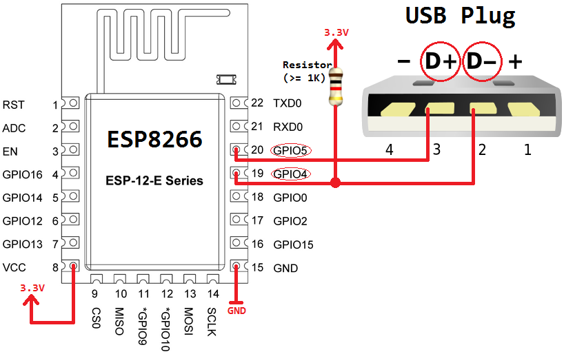

# ESPKeyboard ESP8266 receiver

This ESP8266/ESP8285 firmware receives full keyboard reports over ESP-NOW and
emulates a low-speed USB HID keyboard on GPIO4 (D-) and GPIO5 (D+). It presents
a single boot-protocol keyboard interface with one interrupt IN endpoint.

The USB bit timing depends on an 80 MHz CPU clock. The supplied
`sdkconfig.defaults` selects that clock.

## Requirements

- ESP8266 RTOS SDK 3.4.0
- The Xtensa LX106 toolchain installed and configured by that SDK
- An ESP8266 or ESP8285 receiver board wired for USB
- An ESP32-S3 transmitter running [`../esp32-s3/`](../esp32-s3/)

ESP8266 RTOS SDK 3.4.0 is separate from ESP-IDF; keep it alongside your
ESP-IDF installation and use its own toolchain environment. The v3.4 `idf.py`
does not use the newer `set-target` command:

```text
.\install-esp8266-sdk.ps1
.\build.ps1 -Menuconfig
.\build.ps1
.\build.ps1 -Flash -Port COM3
```

The installer keeps the SDK and its tools separate from ESP-IDF. It requires
Git for Windows and Python 3; it does not change the system `PATH` or the
existing ESP-IDF installation. Pass `-SdkPath` (and optionally `-ToolsPath`)
to either script to choose different install locations. Use
`.\build.ps1 -Menuconfig` to configure the receiver without modifying your
global ESP-IDF environment. Replace `COM3` with the board's serial port when
flashing.

## Pairing

1. Build and flash both projects once with their default settings. The default
   peer MAC is intentionally invalid, so ESP-NOW stays disabled until paired.
2. Read each board's **Station MAC** from its serial log. The station MAC is
   printed even when the peer address is not configured yet.
3. In each project's menuconfig, open **ESPKeyboard ESP-NOW link**. For the
   receiver, run `.\build.ps1 -Menuconfig` from its project directory.
   Set **ESP-NOW channel** to the same legal channel on both devices and set
   **Paired ... station MAC address** to the other board's Station MAC.
4. Build and flash both projects again.

The receiver accepts reports only from its configured peer MAC. ESP-NOW packets
are not encrypted in this initial version; the MAC filter is pairing, not
cryptographic authentication. Use these boards in a trusted RF environment.
Both firmwares disable Wi-Fi power save and pin the radio to the configured
channel while running. The receiver resynchronizes the packet sequence when the
transmitter reboots, and ignores incoming reports entirely until a USB host has
selected a configuration, so no stale keystrokes are replayed on connection.

## USB wiring

- GPIO4 to USB D-
- GPIO5 to USB D+
- Common ground to USB ground
- The D- pull-up and other board wiring must follow the circuit shown below



GPIO4 and GPIO5 are the defaults in [`user/usb_config.h`](user/usb_config.h). The two USB GPIOs must be adjacent and D- must be the lower-numbered pin. The device supports low-speed USB only (1.5 Mbit/s); it is not suitable for USB serial or high-throughput devices.

## Sending HID input reports

The application can submit reports using the APIs in [`user/usb.h`](user/usb.h):

- `usb_send_keyboard_report()` accepts eight bytes: modifier, reserved byte, and six key usages.
- `usb_get_keyboard_leds()` returns the latest LED state the host sent through
  `SET_REPORT` (bit 0 Num Lock, bit 1 Caps Lock, bit 2 Scroll Lock).

`usb_send_keyboard_report()` copies the report into an internal buffer and returns `ESP_ERR_INVALID_STATE` while the endpoint is still transmitting. Retry after `usb_internal_state.eps[1].send` becomes zero, and keep a single producer task for the endpoint.

## Notes for anyone changing the USB code

USB packet reception runs in a timing-sensitive GPIO interrupt and assembly
routine. Three constraints come from the RTOS SDK and are easy to break:

- Keep the single, direct GPIO ISR registration and the explicit
  `_xt_isr_unmask(1 << ETS_GPIO_INUM)` that follows it. `gpio_isr_register()`
  only attaches the handler; nothing in the SDK enables the GPIO interrupt
  line, and the per-pin `gpio_install_isr_service()` dispatcher adds latency
  that breaks USB reception.
- Anything the interrupt reads must live in RAM. `.rodata` is linked into the
  flash-mapped instruction space, where each byte or half-word load traps into
  the SDK's load/store emulation handler, so the descriptors in
  [`user/usb_config.h`](user/usb_config.h) carry `DRAM_ATTR`. Keep it that way
  when adding descriptors or strings.
- The bit timing assumes an 80 MHz CPU clock. `user/usb.c` fails the build if
  the configuration says otherwise.

The firmware does not implement USB suspend: it keeps driving the bus when the
host suspends the port and will not meet the suspend current limit. After a host
sleep/wake cycle the bus is reset and the host reconfigures the device, which
resets the endpoint data toggles.

Only boot-protocol keyboard input is forwarded by the ESP32-S3 firmware. USB
keyboards that expose only report-protocol interfaces are not supported yet.
ESP-NOW refreshes the latest complete key state and the receiver releases all
keys after a transmitter timeout, but this is not an application-level
acknowledged event log; very short taps can still be lost if both state changes
are missed.

The ESP8266 bit-bangs USB in a timing-sensitive interrupt while Wi-Fi is active.
Validate enumeration and sustained typing with the actual boards, USB wiring,
and radio environment; Wi-Fi activity can affect software-USB timing.
The receiver starts USB first and waits up to two seconds for the host to select
its configuration before starting Wi-Fi, reducing radio interference during
enumeration. If no host configures USB in that interval, ESP-NOW starts anyway.

The firmware build does not use the old `esp82xx` submodule, web server, or
standalone bootloader projects.
